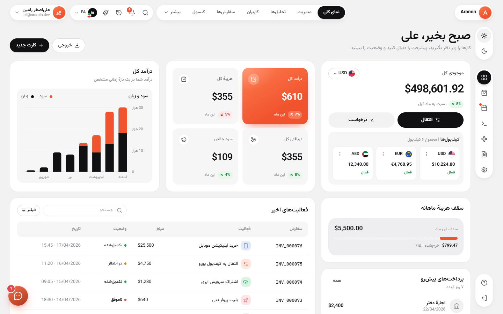
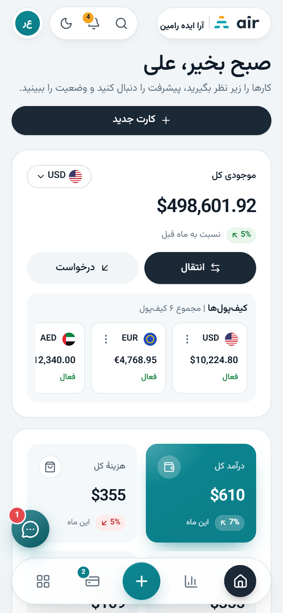
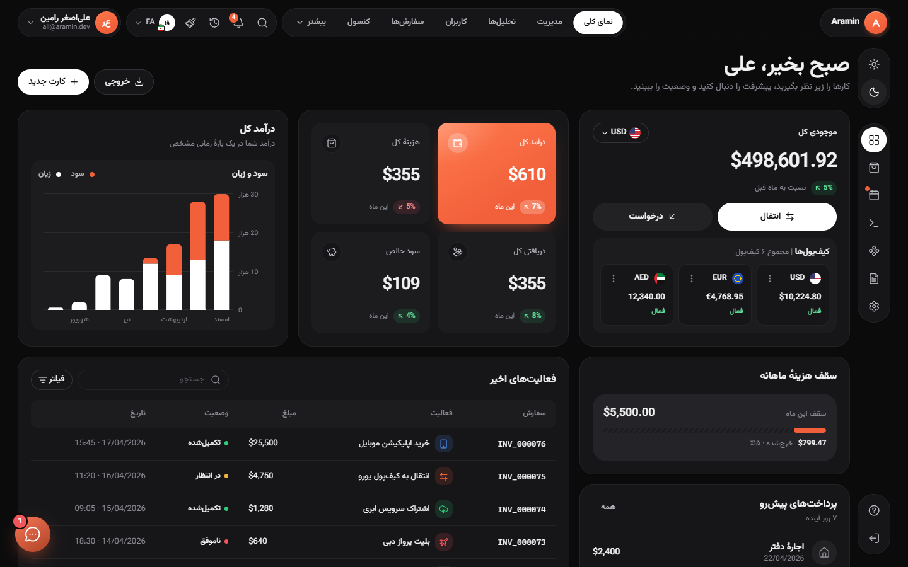
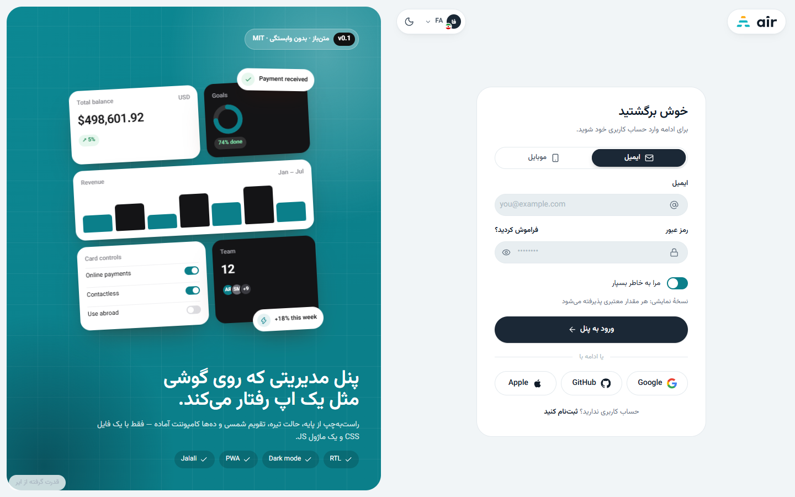
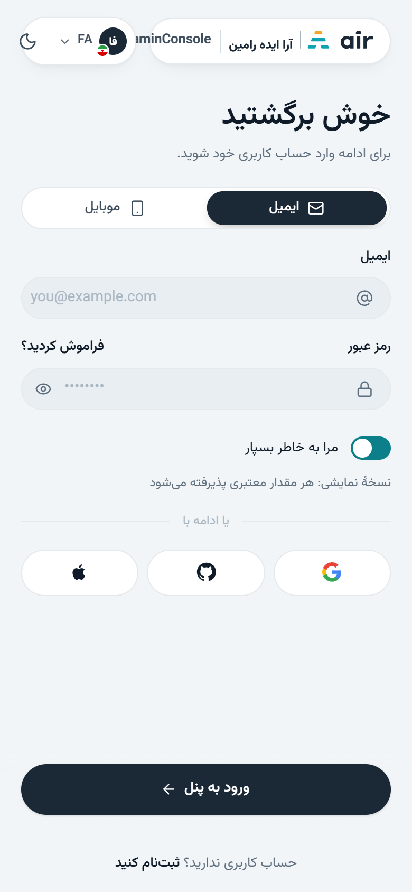
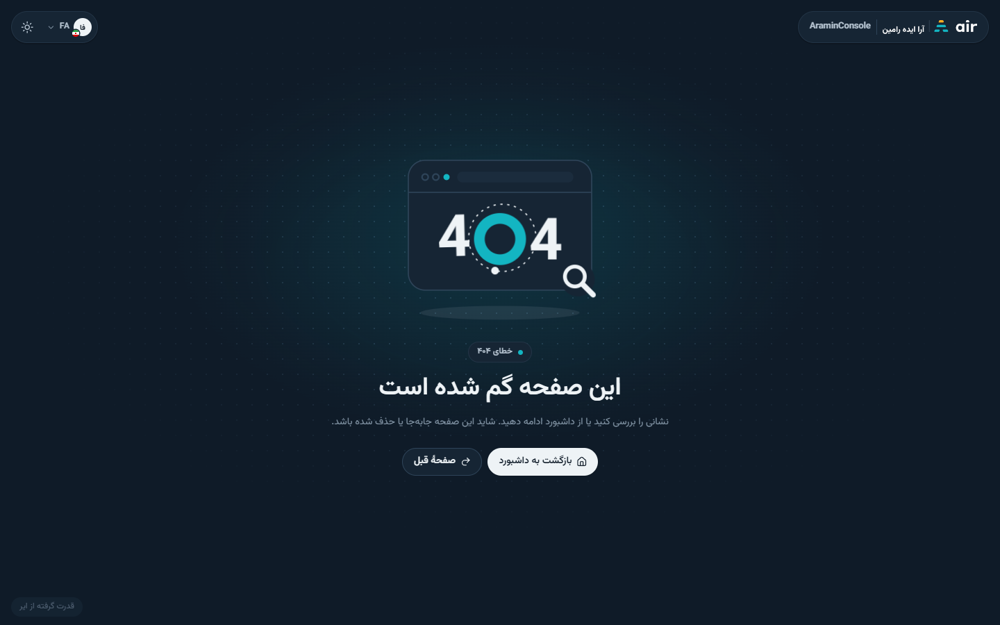

<div align="center">


# AraminConsole

**The zero-dependency, RTL-first admin UI framework that feels like a native app on phones.**
One CSS file, one ES module. Plain HTML, Laravel Blade, Next.js, or anything else.

[](https://github.com/ARaminco/AraminConsole/actions/workflows/ci.yml)
[](LICENSE)
[](CHANGELOG.md)


[](https://araminco.github.io/AraminConsole/demo/)

[**Live demo**](https://araminco.github.io/AraminConsole/demo/) · [Getting started](docs/getting-started.md) · [Modules](docs/modules.md) · [Starters](docs/starters.md) · [AI guide](AGENTS.md) · [فارسی](README.fa.md)

</div>

| Dashboard | Phone | Dark mode |
|---|---|---|
|  |  |  |
|  |  |  |

## Why AraminConsole
- **Zero dependencies, zero build to use it.** Copy `dist/`, add one `<link>` and one `<script type="module">`.
- **RTL first, not RTL patched.** Logical CSS properties only; Persian, Arabic, and English switch live.
- **App-like on phones.** Floating tab bar with FAB, collapsing large titles, bottom sheets, swipe actions, pull-to-refresh, safe areas.
- **Built for Iran.** Rial/Toman, Jalali and Hijri calendars, bank cards and logos, Sheba, national ID and mobile validation, official invoice.
- **Declarative.** `data-ac="…"` attributes start components, even on HTML injected later. Each also has an API on `window.AC`.
- **Modular.** 26 modules; bundle all, some, or lazy-load with `AC.use('maps')`.
- **AI-friendly.** [`AGENTS.md`](AGENTS.md), [`llms.txt`](llms.txt), and an [Agent Skill](skills/aramin-console/SKILL.md) let any coding assistant build with it correctly.

## Features and modules
Sizes are minified + gzip, from `dist/modules/modules.json`.

| Module | What it does | Docs | JS gzip | CSS gzip |
|---|---|---|---:|---:|
| `core` | Tokens, app shell, buttons/cards/tables/forms, `AC` runtime, i18n, theme, formatting | [getting-started.md](docs/getting-started.md) | 16.5 KB | 24.0 KB |
| `shell` | Rail, dock, tab bar, large titles, tabs, command palette, pull-to-refresh | [CONVENTIONS.md](docs/CONVENTIONS.md) | 8.3 KB | 2.9 KB |
| `overlays` | Modal, bottom sheet, drawer, menus, popover, tooltip, confirm/prompt, toast | [overlays.md](docs/overlays.md) | 15.7 KB | 5.2 KB |
| `customizer` | Live theme customizer drawer | [theming.md](docs/theming.md) | 3.1 KB | — |
| `langpicker` | Language picker (fa/en/ar) | [rtl.md](docs/rtl.md) | 2.9 KB | 1.6 KB |
| `forms` | Inputs, OTP, combobox, tags, dropzone, validation, wizard | [forms.md](docs/forms.md) | 17.9 KB | — |
| `datepicker` | Jalali / Gregorian date and time pickers | [forms.md](docs/forms.md) | 8.6 KB | 2.1 KB |
| `data-display` | Lists with swipe actions, tree, accordion, code / JSON / log viewers | [data.md](docs/data.md) | 7.1 KB | 3.0 KB |
| `table` | Data table: sort, filter, paging, selection, card mode on phones | [data.md](docs/data.md) | 8.4 KB | — |
| `chart` | Inline-SVG line, area, bar, donut, gauge, sparkline, heatmap | [data.md](docs/data.md) | 9.9 KB | 2.4 KB |
| `apps` | Kanban, split view, calendar-style app screens | [data.md](docs/data.md) | 4.0 KB | 6.4 KB |
| `money` | Rial/Toman, bank cards, Sheba, bank logos, finance kit | [finance.md](docs/finance.md) | 15.8 KB | 3.2 KB |
| `chat` | Chat UI | [support-chat.md](docs/support-chat.md) | 16.4 KB | 6.5 KB |
| `files` | File manager with uploads and previews | [files.md](docs/files.md) | 50.7 KB | 11.1 KB |
| `invoice-ir` | Official Iranian invoice (print-ready) | [invoice-ir.md](docs/invoice-ir.md) | 11.1 KB | 4.2 KB |
| `mail` | Mail client UI | [data.md](docs/data.md) | 18.4 KB | 5.6 KB |
| `maps` | Map and location picker (no API key) | [maps.md](docs/maps.md) | 26.7 KB | 5.2 KB |
| `marketing` | Landing blocks: hero, pricing, testimonials | [marketing.md](docs/marketing.md) | 13.2 KB | 3.5 KB |
| `notify` | Notification center and preferences | [notifications.md](docs/notifications.md) | 12.8 KB | 3.9 KB |
| `prose` | Rich-text / article typography and editor | [prose.md](docs/prose.md) | 11.3 KB | 6.8 KB |
| `pwa` | Install card, offline, update flow | [pwa.md](docs/pwa.md) | 10.2 KB | 3.0 KB |
| `support-chat` | Support chat widget | [support-chat.md](docs/support-chat.md) | 8.3 KB | 4.1 KB |
| `terminal` | Terminal view | [data.md](docs/data.md) | 2.0 KB | 1.1 KB |
| `tickets` | Ticketing with SLA timers | [tickets.md](docs/tickets.md) | 15.4 KB | 4.8 KB |
| `uptime` | Uptime / status bars | [data.md](docs/data.md) | 1.1 KB | 0.7 KB |
| `user-panel` | Profile completeness, privacy settings | [forms.md](docs/forms.md) | 2.1 KB | 2.8 KB |

## Quick start
```bash
git clone https://github.com/ARaminco/AraminConsole.git
cp -r AraminConsole/dist ./public/aramin     # dist/ is committed: no npm install needed
```
```html
<!doctype html>
<html lang="en" dir="ltr" data-ac-icons="/aramin/icons.svg">
<head>
  <meta charset="utf-8">
  <meta name="viewport" content="width=device-width, initial-scale=1, viewport-fit=cover">
  <script src="/aramin/aramin-console-boot.js"></script>   <!-- saved theme/lang before first paint -->
  <link rel="stylesheet" href="/aramin/aramin-console.min.css">
  <script type="module" src="/aramin/aramin-console.min.js"></script>
</head>
<body>
  <div class="ac-card"><div class="ac-card__body">
    <button class="ac-btn ac-btn--primary" type="button"
            onclick="AC.toast({ title: 'Saved', tone: 'success' })">Save</button>
  </div></div>
</body>
</html>
```
Ready-made projects: [`starters/html`](starters/html), [`starters/laravel-blade`](starters/laravel-blade), [`starters/nextjs`](starters/nextjs) ([docs/starters.md](docs/starters.md)). This repository is also a GitHub template: click **Use this template**.

## `data-ac` usage
```html
<div class="ac-segmented" data-ac="segmented">…</div>             <!-- ac:segmented:change -->
<form class="ac-form" data-ac="form">                              <!-- validation + ac:form:submit -->
  <input class="ac-input" name="mobile" data-ac-rules="required|iran-mobile">
</form>
<div class="ac-otp" data-ac="otp" data-length="6"></div>           <!-- ac:otp:complete -->
<div class="ac-chart-slot" data-ac="chart" data-ac-config='{"type":"bar","series":[{"data":[3,5,2]}]}'></div>
<span data-ac="counter" data-to="498601.92" data-decimals="2" data-prefix="$">0</span>
```
```js
import { AC } from './aramin-console.js';           // also available as window.AC
AC.modal.open('#edit');  await AC.confirm({ title: 'Delete?' });  AC.theme.set({ theme: 'dark', accent: 'blue' });
document.addEventListener('ac:form:submit', (e) => e.detail.waitUntil(fetch('/api', { method: 'POST', body: e.detail.formData })));
```
Events always follow `ac:<component>:<event>` and bubble.

## Modular and custom builds
```bash
node scripts/build.mjs --modules=forms,table,chart --out=dist/custom     # core + chosen modules (+ dependencies)
```
```js
await AC.use('maps');                  // lazy-load a module (JS + CSS) on demand
```
Or keep an `aramin.config.json` in your project. Details in [docs/modules.md](docs/modules.md).

## Theming tokens
Everything is a CSS custom property (`--ac-*`); dark mode is a token swap.

| Token | Purpose |
|---|---|
| `--ac-accent`, `--ac-accent-2` | accent and gradient partner |
| `--ac-ink`, `--ac-ink-contrast` | primary buttons, active nav pill |
| `--ac-bg`, `--ac-surface-1/2/3`, `--ac-border` | canvas, cards, hairlines |
| `--ac-text`, `--ac-muted`, `--ac-faint` | text levels |
| `--ac-r-xl`, `--ac-r-pill`, `--ac-control-h` | radius and density |
| `--ac-font` | one font (Vazirmatn) for every script |

Switches on `<html>`: `data-theme="light|dark"`, `data-accent="orange|violet|blue|emerald|rose|amber|slate"`, `data-density="comfortable|compact"`, `data-radius="sharp|default|round"`. Full list: [docs/theming.md](docs/theming.md).

## RTL and i18n
Set `<html lang="fa" dir="rtl">` or call `AC.i18n.set('en')`; it switches `lang`, `dir`, and every `[data-i18n]` text from JSON dictionaries (`AC.i18n.configure({ url: '/i18n/{lang}.json' })`). Latin digits by default, Persian digits with `AC.i18n.setDigits('native')`. See [docs/rtl.md](docs/rtl.md).

## Iranian toolkit
Rial and Toman (`data-ac="money"`, `money-unit`), Jalali and Hijri calendars on `Intl` with no date library, bank cards with Iranian bank logos, Sheba field with bank detection, `iran-mobile` and `iran-national-id` validators, and a print-ready official invoice. See [docs/finance.md](docs/finance.md), [docs/invoice-ir.md](docs/invoice-ir.md), [docs/forms.md](docs/forms.md).

## Browser support
Current Chrome, Edge, Firefox, Safari (desktop and iOS 16.4+), Samsung Internet. Uses CSS logical properties, `color-mix()`, `:has()`, `dvh`, and the Popover API (with fallback); View Transitions when available.

## Accessibility
Focus traps, roving tabindex, ARIA states, visible focus rings, 44px touch targets, `prefers-reduced-motion` support, and contrast-checked tokens in both themes.

## "Powered by AIR" credit
The base template shows a small `.ac-powered` link («قدرت گرفته از ایر» / "Powered by AIR" / «مدعوم من AIR») to <https://air.co.ir/>: bottom of the rail on desktop, end of content on phones, footer of auth and error pages. The MIT license lets you remove or replace it:
- delete the `<a class="ac-powered" …>` elements in your pages, or
- change the text with the `credit.powered` key in your i18n JSON and the `href` on the link.

We kindly ask that you keep it in the base template and starters you redistribute.

## Roadmap
- npm publication and a versioned CDN build
- More starters (Vue, SvelteKit, Django templates)
- Visual regression tests in CI
- Figma tokens export

## Contributing
Issues and pull requests are welcome: [CONTRIBUTING.md](CONTRIBUTING.md), [Code of Conduct](CODE_OF_CONDUCT.md), [Security policy](SECURITY.md). Run `npm run dev`, then open http://localhost:5178/demo/. AI assistants: read [AGENTS.md](AGENTS.md) first.

## Credits
- Icons: [Lucide](https://lucide.dev), ISC License (`dist/LICENSE-lucide.txt`).
- Font: [Vazirmatn](https://github.com/rastikerdar/vazirmatn) by Saber Rastikerdar, SIL Open Font License 1.1 (`src/fonts/OFL.txt`).
- Visual direction inspired by the "Dashboard V14 — Modern & Minimal UI" concept by code.xr.
- Bank logos (`dist/banks.svg`): Iranian banks from [@iran-utils/iranian-banks-icons-core](https://github.com/houtan-rocky/iranian-banks-react-icons) (MIT); card networks and international banks from [simple-icons](https://simpleicons.org) (CC0); a few are generated monograms. **All bank and card-network logos are trademarks of their respective owners and are included for identification only.** Sources: `src/banks/SOURCES.md`, notice: `dist/LICENSE-bank-logos.txt`.

## License
[MIT](LICENSE) © 2026 Ali Asghar Ramin

<div align="center">

**Powered by [AIR](https://air.co.ir/)** — https://air.co.ir/

</div>
